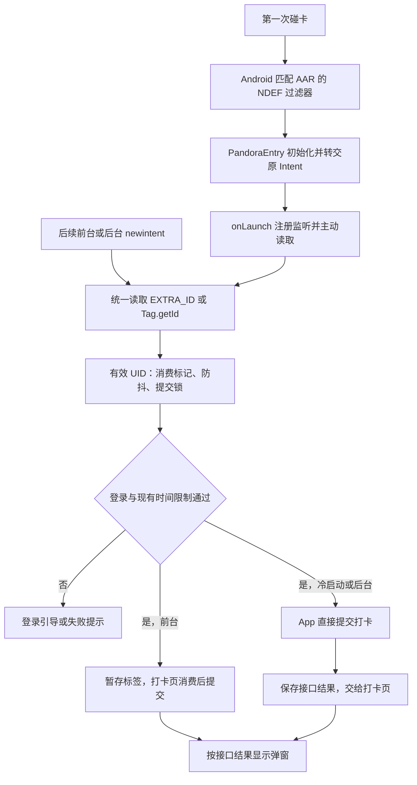

# NFC 冷启动问题修复原理

整理日期：2026-11-04。代码基准：喵呜打卡 `1.4.5 / versionCode 105`，对应提交 `5345313`。

本文说明本项目为什么曾经需要碰卡两次，以及如何通过 Android 启动入口、Intent 读取和页面结果交接，让第一次碰卡即可唤起应用、获取 UID 并提交打卡。

## 1. 修复结论

这次修复贯通了两段流程：**Android 把带卡片数据的 NFC Intent 交给正确的启动入口；应用启动后立即读取这个 Intent，再持续监听后续碰卡。**

原来的现象是：APP 未打开时，第一次碰卡只能启动 APP；APP 打开后再碰一次，才取得 UID。第二次能够读到，说明前台读卡流程可以工作，但首次启动时的 NFC 数据交接不完整。

修复后的关键变化如下：

| 环节 | 原来存在的问题 | 现在的处理 |
| --- | --- | --- |
| 卡片内容匹配 | 现场卡片写的是包名启动记录，仅处理 `mycheckin://` 不匹配 | 增加 AAR 对应的 NDEF 过滤规则 |
| 原生启动入口 | 曾把 NFC 入口挂到未对外导出的内部 Activity，出现无法拉起 APP | 使用 `io.dcloud.PandoraEntry` 正常启动入口 |
| 冷启动读取 | 只等后续事件会漏掉已放进启动 Intent 的卡片 | `onLaunch` 注册监听后，立即主动读取当前 Intent |
| 初始化时序 | 初次读取时，桥接或卡片数据可能尚未就绪 | 保留数据，每隔 100ms 重试，最多再试 5 次 |
| 重复通知 | 同一次启动可能被多次通知 | 消费标记、UID 防抖、提交锁共同防重 |
| 结果展示 | 上传可能早于页面就绪，只有事件通知容易漏掉弹窗 | 先保存结果，再由页面一次性消费并显示动画 |

## 2. 现场卡片实际写入了什么

NFC Tools 中的“启动应用”写入的是 Android Application Record，简称 AAR：

```text
NDEF 记录类型：External / android.com:pkg
记录内容：uni.app.UNI35FA817
整条记录长度：36 字节
本次实机卡片 UID：5310C716430001
```

现场记录的复现数据保存在 [nfc-package-record.json](D:/App/NFC-TAG/tests/fixtures/nfc-package-record.json)。包名用于选择要启动的应用，硬件 UID 用于本项目的卡片校验，两者分别从不同位置取得。

Android 对 External 类型记录使用 `vnd.android.nfc://ext/<记录类型>` 进行 Intent 匹配，所以本卡片对应 `vnd.android.nfc://ext/android.com:pkg`。AAR 还允许系统按包名选择应用，因此“APP 被打开”本身不足以证明具体 Activity 已收到本次 NFC 数据。[Android 官方说明](https://developer.android.com/develop/connectivity/nfc/nfc#aar)

本次排查据卡片内容、入口配置和复现现象，定位到首次启动的分发链路。没有改写卡片，也没有用包名或协议链接代替 UID。

## 3. 第一步：修正 Android 原生启动入口

修改位置：[AndroidManifest.xml](D:/App/NFC-TAG/AndroidManifest.xml:1)。现有 NFC 权限继续由 [manifest.json](D:/App/NFC-TAG/manifest.json) 配置，根目录清单补充 Activity 的 NFC 入口：

```xml
<?xml version="1.0" encoding="utf-8"?>
<manifest xmlns:android="http://schemas.android.com/apk/res/android"
    package="uni.app.UNI35FA817">
    <application>
        <activity android:name="io.dcloud.PandoraEntry"
            android:exported="true">
            <intent-filter>
                <action android:name="android.nfc.action.NDEF_DISCOVERED" />
                <category android:name="android.intent.category.DEFAULT" />
                <data android:scheme="vnd.android.nfc"
                    android:host="ext"
                    android:path="/android.com:pkg" />
            </intent-filter>
            <intent-filter>
                <action android:name="android.nfc.action.NDEF_DISCOVERED" />
                <category android:name="android.intent.category.DEFAULT" />
                <data android:scheme="mycheckin" />
            </intent-filter>
            <intent-filter>
                <action android:name="android.nfc.action.TAG_DISCOVERED" />
                <category android:name="android.intent.category.DEFAULT" />
            </intent-filter>
        </activity>
    </application>
</manifest>
```

三个过滤器分别负责现场包名启动卡片、`mycheckin` 协议卡片，以及走到 `TAG_DISCOVERED` 分发阶段的卡片。`TAG_DISCOVERED` 是兜底入口，不能替代现场 AAR 的精确匹配。

### 为什么选择 PandoraEntry

本次排查的 DCloud 运行时启动链路是：

```text
系统 NFC Intent
  → io.dcloud.PandoraEntry
  → 初始化应用运行时
  → 把原 NFC Intent 转交给 io.dcloud.PandoraEntryActivity
  → JS 通过 runtimeMainActivity().getIntent() 读取
```

曾经将过滤器直接配置到内部的 `io.dcloud.PandoraEntryActivity`。但现场安装的 `1.4.1` APK 中，该 Activity 最终没有对外导出，ADB 发起同类启动请求时报出：

```text
Permission Denial ... not exported
```

这对应后来“碰卡有反应，但打不开 APP”的故障。改用正常入口 `PandoraEntry` 后，同类冷启动请求返回 `Status: ok`。正常入口还承担运行时初始化，因此保留它原有的启动和 Intent 转交流程。

这个结论来自本项目实际打包产物和启动排查。后续升级 HBuilderX 时，仍应检查最终 APK 合并后的清单。

## 4. 第二步：冷启动主动读取，后续碰卡持续监听

### 4.1 在 onLaunch 接住第一次碰卡

修改位置：[App.vue 的 onLaunch](D:/App/NFC-TAG/App.vue:14) 和 [listenForNfcIntents](D:/App/NFC-TAG/utils/nfc-checkin.js:129)。

冷启动时，NFC 数据可能已经存在于 Activity 的启动 Intent 中。后面才注册的 `newintent` 监听，并不等于能重新收到这次启动事件。因此初始化时执行两个动作：

```javascript
// listenForNfcIntents 的核心节选
currentHandler = handler
unhandledIntentHandler = onUnhandledIntent
if (!intentListenerRegistered) {
    plus.globalEvent.addEventListener('newintent', handleNewIntent)
    intentListenerRegistered = true
}
handleNewIntent() // 注册后主动读取当前启动 Intent
```

`App.vue` 在 `onLaunch` 调用该方法：冷启动或后台唤起走 `handleBackgroundNfc`；前台碰卡走 `handleNfcTag`。两个入口共用同一套原生 UID 读取逻辑。

这里的 `background` 是按收到事件时前台调度是否开启进行分类，用来选择处理路径；它不表示 APP 进程被关闭后仍有 JS 持续运行。冷启动仍由 Android NFC 分发负责唤起应用。

### 4.2 优先读取 EXTRA_ID，再读取 Tag.getId()

修改位置：[readCurrentNfcIntent](D:/App/NFC-TAG/utils/nfc-checkin.js:66)。核心节选如下，省略了异常处理和消费标记检查：

```javascript
const activity = plus.android.runtimeMainActivity()
const NfcAdapter = plus.android.importClass('android.nfc.NfcAdapter')
const intent = activity.getIntent()
if (!intent) return null
plus.android.importClass(intent)

let uid = bytesToUid(intent.getByteArrayExtra(NfcAdapter.EXTRA_ID))
if (!uid) {
    const tag = intent.getParcelableExtra(NfcAdapter.EXTRA_TAG)
    if (!tag) return null
    plus.android.importClass(tag)
    uid = bytesToUid(tag.getId())
}
if (!uid) return null
clearNfcExtras(activity, intent, NfcAdapter)
return { uid }
```

`EXTRA_ID` 直接提供字节数组，可减少对 `Tag` 对象反序列化的依赖；没有它时继续尝试 `EXTRA_TAG`。这两个字段的含义可见 [NfcAdapter 官方参考](https://developer.android.com/reference/android/nfc/NfcAdapter#EXTRA_ID)。

读取时以原生 extra 为依据，没有限定“action 必须等于 `NDEF_DISCOVERED`”。这样即使运行时包装了 action，只要卡片数据仍在，也有机会取得 UID。

字节转字符串使用 [bytesToUid](D:/App/NFC-TAG/utils/nfc-checkin.js:57)：

```javascript
uid += (Number(bytes[index]) & 0xff).toString(16).padStart(2, '0')
```

`& 0xff` 还原 Java 有符号 byte，`padStart(2, '0')` 保留前导零，最后统一转为大写。例如 `53:10:C7:16:43:00:01` 转为 `5310C716430001`，不反转字节顺序。

### 4.3 读取失败时短暂重试，成功后再消费

修改位置：[dispatchCurrentTag](D:/App/NFC-TAG/utils/nfc-checkin.js:100) 和 [clearNfcExtras](D:/App/NFC-TAG/utils/nfc-checkin.js:46)。

启动时立即读一次；如果桥接异常、Intent 暂未到位或 UID 暂时为空，则每隔 100ms 重试，最多再试 5 次。一次读取加五次重试，最长约等待 500ms。

读取失败时保留原 Intent；取得有效 UID 后，才移除 `EXTRA_TAG`、`EXTRA_ID`、`EXTRA_NDEF_MESSAGES`，并设置：

```javascript
intent.putExtra('mycheckin.nfc.CONSUMED', true)
activity.setIntent(intent)
```

启动链接和其他参数继续保留。后续通知如果再次读到这个已消费的 Intent，就直接结束，避免把同一次碰卡错误地降级为“请再次碰卡”。

重试只能处理数据到达时序，不能补出系统没有传来的 UID。重试后仍只有普通 `mycheckin://` 链接时，现有降级流程会要求再次碰卡验证。

### 4.4 前台开启调度，后台保留监听

生命周期由 [App.vue](D:/App/NFC-TAG/App.vue:25) 管理：

| 时机 | 操作 | 作用 |
| --- | --- | --- |
| `onLaunch` | 注册唯一的 `newintent` 监听，并读取当前 Intent | 处理第一次启动携带的卡片 |
| `onShow` | `startNfcScan()` 开启前台调度 | 处理 APP 已打开时的碰卡 |
| `onHide` | `stopNfcScan()` 关闭前台调度，保留事件监听 | 继续接收后台唤起时的新 Intent |

前台使用可变 `PendingIntent`，让系统填入卡片数据；本实现对 API 31 及以上设置 `FLAG_MUTABLE`，同时保留 `FLAG_UPDATE_CURRENT` 和 `FLAG_ACTIVITY_SINGLE_TOP`。[Android 前台调度官方说明](https://developer.android.com/develop/connectivity/nfc/advanced-nfc#foreground-dispatch)

## 5. 第三步：一次碰卡只触发一次提交

防重复分成三层，分别处理不同情况：

| 机制 | 处理的问题 |
| --- | --- |
| Intent 消费标记 | 同一个启动 Intent 被冷启动、后续通知再次读取 |
| 同 UID 1 秒防抖 | 卡片贴在手机上时连续触发多个扫描通知 |
| 全局提交锁 | 前后台入口交叠，或上一次打卡请求仍在处理中 |

提交锁正常情况下在请求结束时释放，30 秒是兜底释放时间，并不要求用户每次打卡等待 30 秒。它属于客户端防重措施，不能当作服务端永久幂等保证。

冷启动、后台唤起时，由 [handleBackgroundNfc](D:/App/NFC-TAG/App.vue:70) 直接调用打卡接口；前台碰卡先暂存标签，再由打卡页消费并提交。两条路径都先检查登录状态和现有时间限制。

修复后的完整流程如下：



## 6. 成功弹窗为什么也需要结果交接

读到 UID、服务器确认成功、页面显示成功，是三个不同的阶段。

[api/checkin.js](D:/App/NFC-TAG/api/checkin.js) 把实际 UID、打卡点和设备标识提交至 `POST /api/checkin`。当前成功条件为 HTTP `200` 且业务码 `code === 0`。页面据此决定显示成功或失败。

冷启动时，接口可能先于页面返回。如果只发一个页面尚未订阅的事件，成功提示就会丢失。`1.4.5` 的处理是：

1. `App.vue` 先用 `setPendingCheckinResult` 保存已完成请求的结果。
2. 当前已在打卡页时，发送 `checkin-result-ready` 通知；其他页面则返回打卡页。
3. 页面在 `onShow` 和收到通知时，都调用 `showPendingCheckinResult`。
4. 结果读取后立即移除，超过一分钟失效，退出登录也会清除。

具体代码见 [session.js 的结果交接函数](D:/App/NFC-TAG/utils/session.js:115) 和 [打卡页的结果消费方法](D:/App/NFC-TAG/pages/checkin/index.vue:194)。这里传递的是已提交请求的结果，不把它重新当成待提交的标签，因此不会为了弹窗再上传一次。

原有猫咪结果组件 [checkin-result/index.vue](D:/App/NFC-TAG/components/checkin-result/index.vue) 已接回这条流程，成功时展示庆祝动画、星光、确认勾、打卡时间和一次轻振；失败时展示实际原因。页面内提示不依赖 Push 模块，避免之前“打包时未添加 push 模块”的运行时弹窗。

## 7. 打卡时间限制保持原实现

时间限制继续只用 [checkin-record.js 中的现有开关](D:/App/NFC-TAG/utils/checkin-record.js:80) 管理：

```javascript
export const CHECKIN_TIME_LIMIT_ENABLED = true
```

`true` 启用原来的时间判断，`false` 临时放开前端时间限制。`getCheckinWindowStatus` 的时间段、边界和判断算法没有重写，也没有另加一套时间限制。

`1.4.3` 曾临时关闭此开关用于实机上传测试；当前 `1.4.5` 保持开启，UID 调试弹窗已移除。非允许时段的拒绝提示属于业务判断，应与“未读到 UID”分开排查。

## 8. 验证结果与复现方法

### 已保存的实机证据

证据见 [2026-11-04 实机验证记录](D:/App/NFC-TAG/unpackage/nfc-qa/verification-2026-11-04.json)。该记录位于本地构建目录，可能不随 Git 提交，因此关键结果列在下表：

| 检查 | 实际结果 |
| --- | --- |
| 手机 | vivo V2502A，Android 16 |
| `1.4.2 / 102` 首次读卡验证 | 碰卡前进程不存在；第一次碰卡启动新进程，取得 `5310C716430001` |
| `1.4.3 / 103` 上传验证 | 冷启动碰卡后，HTTP `200`、业务码 `0`、`success: true` |
| 服务器流水 | 总数从 `87` 增至 `88`；新增 ID `171`，时间 `2026-11-04 15:21:37` |
| 成功 POST 次数 | 观察到 `1` 次 |
| 钉钉状态 | `dingtalkSync: pending`，当时未验证最终回执 |

以上证明首次 UID 读取和本应用服务器的打卡流水上传已通过实机验证。钉钉排队状态需要与最终同步结果区分。

`1.4.5 / 105` 已通过 30 项回归、4 种手机尺寸/状态预览，以及最终 APK 的签名、版本、原生入口和编译资源检查；截至本文整理时，该版本尚未覆盖安装并再次实机碰卡。构建检查见 [1.4.5 校验记录](D:/App/NFC-TAG/unpackage/nfc-qa/release-1.4.5-verification.json)。

### 本地回归与清单检查

在 `D:\App\NFC-TAG` 下运行：

```powershell
node --test tests/nfc-checkin.test.cjs tests/checkin-window.test.cjs
powershell -NoProfile -File tests/check-nfc-manifest.ps1
```

回归覆盖冷启动已有 Intent、Intent 延迟到达、仅有 `EXTRA_ID`、桥接短暂失败、前后台切换、重复通知、请求失败，以及接口先返回或页面先加载两种结果交接顺序。时间窗测试调用现有函数校验原边界。

手机连接并允许 USB 调试后，可检查已安装 APK 的三类入口与版本：

```powershell
powershell -NoProfile -File tests/check-nfc-device.ps1 -AdbPath 'D:\Hbuilderx\HBuilderX\plugins\launcher-tools\tools\adbs\adb.exe'
```

该脚本应确认 AAR、`mycheckin` 和 Tag 三类请求均匹配对外导出的 `io.dcloud.PandoraEntry`，且手机版本与源码一致。它只查询配置，不模拟实际卡片。

实际验收时，登录后回到桌面，退出 NFC Tools，并确认应用进程已结束、不是仅切到后台，也不是被设置为系统强行停止状态。保持手机解锁，在允许时段碰实体卡一次并移开，核对启动、接口结果和服务器新增流水；再分别检查后台唤起、前台碰卡与连续通知。

正式包的上传和远端流水摘要同时写入 Android 日志，可通过以下命令查看：

```powershell
& 'D:\Hbuilderx\HBuilderX\plugins\launcher-tools\tools\adbs\adb.exe' logcat -s NfcCheckin:I
```

日志中的 UID、打卡点、HTTP 状态、业务码与远端流水用于串联读卡到上传的过程；现有诊断日志不输出登录 Token。

### 为什么必须完整打包

NFC 启动入口属于原生清单。修改根目录 `AndroidManifest.xml` 后，需要重新云打包或生成包含该配置的自定义基座；热更新页面资源无法更新手机已安装 APK 的 Activity 入口。

覆盖安装继续使用相同包名与签名，并检查最终 APK 和已安装版本。ADB 能唤起 Activity 只能证明入口可达，真实的 Tag/UID 数据仍需用实体卡验证。

## 9. 后续维护时保留的关键点

- AAR 的 NDEF 过滤器继续挂在本项目正常启动入口 `PandoraEntry`，升级运行时后检查合并产物。
- `onLaunch` 同时执行“注册监听”和“主动读取”；`onHide` 只停止前台调度，保留 `newintent` 监听。
- 取得有效 UID 后再消费 NFC extra，保留已消费标记，读取失败时允许短暂重试。
- 冷启动/后台与前台各自提交一次；已完成请求的结果只用于展示。
- 时间限制继续管理 `CHECKIN_TIME_LIMIT_ENABLED`，沿用现有判断函数。

本次改动的核心是让第一次碰卡产生的原生数据，从系统启动入口一直传到 JS 提交逻辑；重试、防重和结果交接则分别处理初始化时序、重复通知与页面加载时序。
